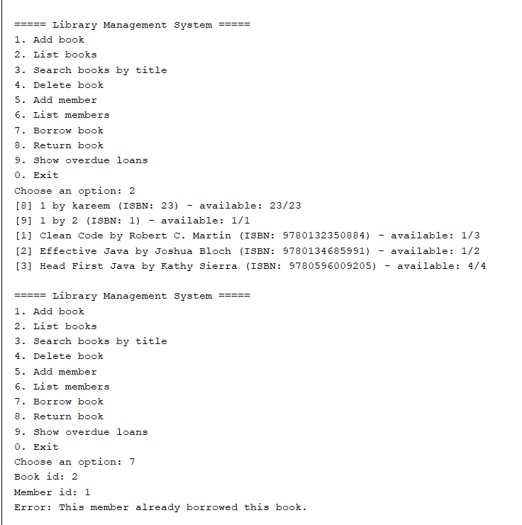
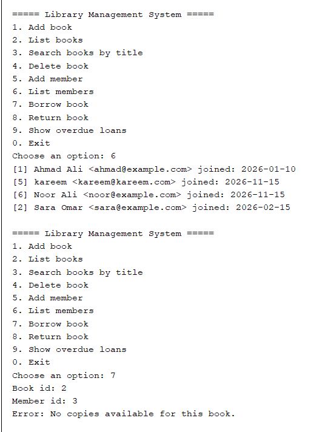

# Library Management System

A console application to manage a library: books, members and loans.
Built with Java, JDBC and MySQL.

## Features
- Add, list, search and delete books
- Add and list members
- Borrow and return books (using a database transaction)
- Show overdue loans

## Technologies
- Java 17
- JDBC
- MySQL
- Maven
- NetBeans

## Project Structure
- `model`: Book, Member, Loan classes
- `dao`: classes that talk to the database
- `service`: the rules of the library (borrow, return, validation)
- `ui`: the console menu
- `util`: database connection
- `exception`: my own exception

## How to Run
1. Install XAMPP and start MySQL.
2. Run `sql/schema.sql` then `sql/sample-data.sql` in phpMyAdmin.
3. If your MySQL has a password, change it in `util/DBConnection.java`.
4. Run `Main.java`.

## Screenshots

